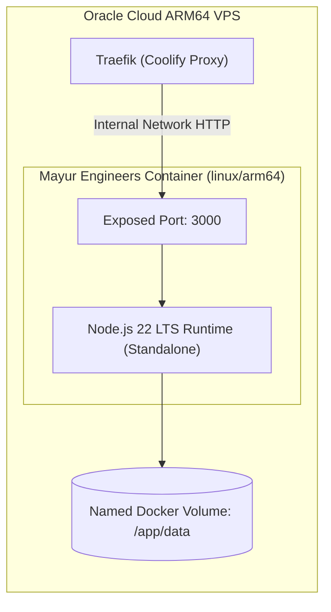

# Architecture Specification & ARM64 Runtime — Mayur Engineers GST Billing Lite

## 1. Runtime Environment: ARM64 (`linux/arm64`)

The target hosting environment is an Oracle Cloud Infrastructure (OCI) Ampere A1 Compute instance powered by ARM64 architecture (Neoverse-N1 processor, `aarch64`).

### ARM64 Constraints & Guarantees
- **No Emulation**: The application must build and run natively on `linux/arm64`. AMD64 translation (e.g. QEMU) must not be forced, as it degrades performance and causes CPU throttling on shared VPS infrastructure.
- **Base Image**: Official `node:22-alpine` with native `linux/arm64` support.
- **Native Binaries**: Any compiled C/C++ or Rust dependencies must have pre-built binaries for `linux/arm64-musl` or compile cleanly in Alpine:
  - `@next/swc-linux-arm64-musl`: Prebuilt native SWC compiler for Next.js.
  - SQLite: Embedded WAL-mode database accessed via native driver with prebuilt ARM64-musl binaries or Node.js native bindings.
  - Zero Headless Chromium: Traditional browser-based PDF generation (Puppeteer/Playwright) is avoided because Chromium on Alpine ARM64 requires heavy shared libraries and consumes 300MB+ RAM. Instead, a lightweight pure-JS or PDFKit stream engine is employed.

---

## 2. Container Topology & Resource Limits

The application is packaged as a **single standalone Docker container**:

### Resource Allocation
- **Container Memory Limit**: Soft limit `256 MB`, Hard limit `384 MB`. Normal baseline RSS: `~120 MB`.
- **CPU Limit**: Maximum 0.5 OCPU burst during build or PDF generation; < 0.05 OCPU during idle/steady state.
- **Disk Storage**: Application container image size `< 180 MB`. SQLite database volume `< 50 MB` initial.

---

## 3. Coolify Integration Guidelines

1. **Build Pack**: Standard `Dockerfile` with multi-stage build:
   - `builder` stage: Installs dependencies, runs build, compiles Next.js standalone output.
   - `runner` stage: Minimal Alpine image copying only standalone server files and static assets.
2. **Port Configuration**: `3000` internally exposed to Traefik.
3. **Persistent Mount**: Docker volume mounted at `/app/data` to ensure SQLite database, WAL files, and uploaded business logos persist across deployments.
4. **Health Check**: Endpoint `/api/health` returning `200 OK` for Coolify zero-downtime health verification.
