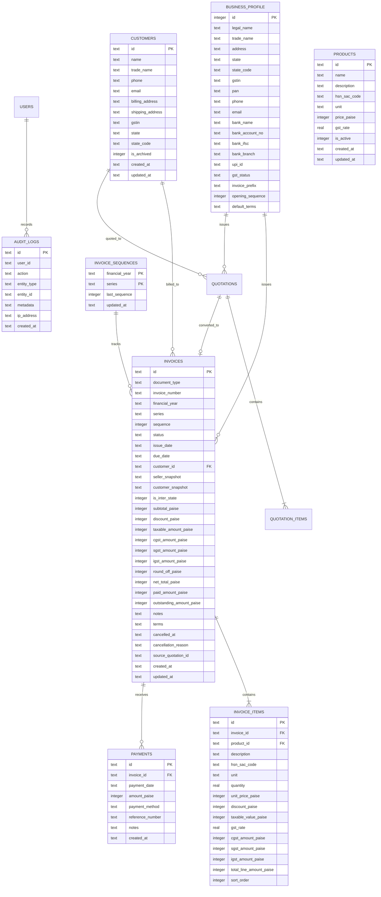

# Data Model Specification — Mayur Engineers GST Billing Lite

## 1. Principles of Financial Data Modeling

1. **Integer Paise Storage**: Every monetary figure is represented as an integer representing paise (1 INR = 100 paise). Floating-point data types (`FLOAT`, `REAL`, `DOUBLE`) are strictly forbidden for currency storage.
2. **Deterministic Rounding**: Any fractional tax splits resulting from line calculations are rounded using Banker's rounding (Half-Even) or Standard Half-Up at line boundaries, with a dedicated `round_off_paise` attribute balancing the invoice total to the exact integer rupee.
3. **Immutable Snapshots**: Issued invoices store immutable JSON representations of both the seller profile and the customer profile as they existed at the exact moment of issuance. Future profile edits do not alter past invoices.
4. **Separation of Payments from Invoices**: Payments exist as separate transaction records linked to invoices, supporting full and partial payments.

---

## 2. Entity Relationship Diagram



---

## 3. Snapshot Data Structures (JSON)

### Seller Snapshot Structure
```json
{
  "legalName": "Mayur Engineers",
  "tradeName": "Mayur Engineers",
  "address": "123 Industrial Area, Phase 2, Pune, Maharashtra 411001",
  "state": "Maharashtra",
  "stateCode": "27",
  "gstin": "27AABCM1234F1Z1",
  "pan": "AABCM1234F",
  "phone": "+91 9876543210",
  "email": "contact@mayurengineers.com",
  "bankName": "State Bank of India",
  "bankAccountNo": "12345678901",
  "bankIfsc": "SBIN0001234",
  "bankBranch": "Pune Main Branch",
  "upiId": "mayurengineers@sbi"
}
```

### Customer Snapshot Structure
```json
{
  "customerId": "cust_123456",
  "name": "Acme Precision Tools Pvt Ltd",
  "tradeName": "Acme Tools",
  "billingAddress": "Plot 45, MIDC Bhosari, Pune, Maharashtra 411026",
  "shippingAddress": "Plot 45, MIDC Bhosari, Pune, Maharashtra 411026",
  "state": "Maharashtra",
  "stateCode": "27",
  "gstin": "27AAACA9876E1Z5",
  "phone": "+91 9123456780",
  "email": "accounts@acmetools.com"
}
```
