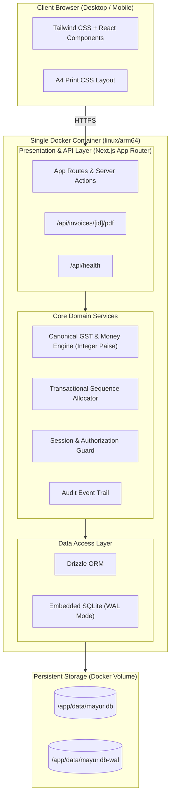

# System Design & Architecture — Mayur Engineers GST Billing Lite

## 1. Architectural Philosophy

Mayur Engineers Billing Lite is designed as a **self-contained modular monolith** optimized for low resource consumption, rock-solid financial consistency, and native ARM64 container execution on Oracle Cloud VPS via Coolify.



---

## 2. Core Modules & Boundaries

1. **Auth & Security (`/src/lib/auth`)**:
   - Manages owner session cookies using cryptographically signed, HTTP-only cookies.
   - Argon2id password verification.
   - Brute-force protection with IP-based rate limiting on sensitive mutation routes.

2. **Calculation Engine (`/src/lib/calculations`)**:
   - Zero-dependency financial domain service.
   - Converts all INR figures to integer paise (1 INR = 100 paise) before mathematical operations.
   - Calculates line subtotals, item discounts, taxable base, CGST, SGST, IGST, and invoice round-off.
   - Used identically across UI live previews, database persistence, PDF generators, and reports.

3. **Numbering Service (`/src/lib/numbering`)**:
   - Manages financial-year boundaries (April 1 to March 31).
   - Generates document identifiers atomically inside SQLite database transactions.
   - Supports configurable prefixes and starting sequences.

4. **Data Access & Schema (`/src/lib/db`)**:
   - Drizzle ORM schema mapping SQLite tables with type-safe queries.
   - Migration runner executing schema evolutions automatically at startup.
   - Connection configured in Write-Ahead Logging (WAL) mode with busy timeout for high concurrency read/write safety.

5. **Document Rendering (`/src/lib/pdf`)**:
   - Browserless server-side PDF generation stream compatible with `linux/arm64`.
   - Matching browser print stylesheet for native `@media print` A4 document generation.

---

## 3. Data Integrity & Concurrency Control

- **Single Writer, Multiple Readers**: SQLite in WAL mode permits concurrent reads while serializing writes without locking read queries.
- **Transactional Atomicity**: Invoice issuance is wrapped in an atomic database transaction:
  ```sql
  BEGIN IMMEDIATE;
  -- 1. Read and increment next sequence counter
  -- 2. Construct immutable seller and buyer snapshots
  -- 3. Insert invoice record with generated number
  -- 4. Insert line items with snapshotted tax breakdown
  -- 5. Record audit event
  COMMIT;
  ```
- **Snapshotted Immutability**: All company details and customer details are frozen into JSON fields on the invoice record at issuance time. Future edits to the customer directory or company profile will never alter previously issued invoices.
