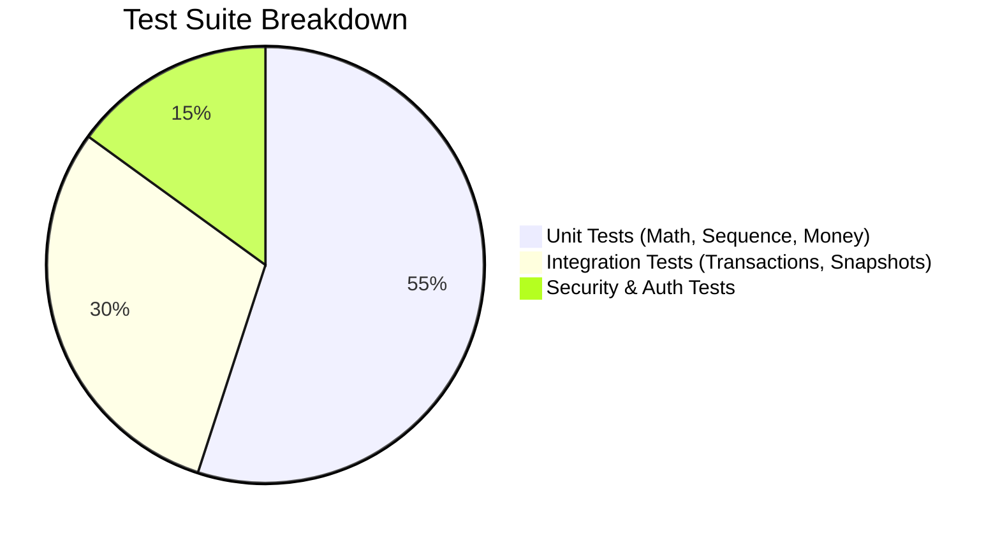

# Testing Strategy Specification — Mayur Engineers GST Billing Lite

## 1. Testing Philosophy

Financial correctness, transactional isolation, and authorization enforcement are core quality requirements. Tests must be automated, repeatable, and run alongside feature development.

No feature or deployment will be considered complete without automated test verification.

---

## 2. Test Pyramid & Coverage Targets



### 2.1 Unit Tests (`tests/unit/`)
- **Canonical Calculation Engine (`gst-calculator.test.ts`)**:
  - Intra-state calculations (50% CGST + 50% SGST split).
  - Inter-state calculations (100% IGST).
  - Mixed item rates on a single invoice (e.g. 5%, 12%, 18%, 28%, 0%).
  - Line-level discount deductions before tax base calculation.
  - Round-off handling: verify positive and negative rounding adjustments round to whole rupees accurately.
  - Zero quantity and fractional quantity handling.
  - Large value arithmetic (preventing integer overflow).
- **Money Formatter (`money.test.ts`)**:
  - Rupee string to integer paise parsing (`"1,234.50"` $\rightarrow$ `123450`).
  - Integer paise to Indian numbering currency display (`12345678` $\rightarrow$ `₹1,23,456.78`).
- **Numbering & Sequence (`sequence-allocator.test.ts`)**:
  - Financial year calculation for dates across boundary months (March vs. April).
  - Sequence zero-padding rules (`1` $\rightarrow$ `001`, `99` $\rightarrow$ `099`, `1000` $\rightarrow$ `1000`).

### 2.2 Integration Tests (`tests/integration/`)
- **Invoice Issuance Lifecycle**:
  - Draft creation $\rightarrow$ Issue transition $\rightarrow$ Number assignment.
  - Verification that `seller_snapshot` and `customer_snapshot` freeze all metadata permanently.
  - Verification that updating customer records does not mutate past invoices.
  - Concurrent issue simulation to verify sequence uniqueness and zero gaps.
- **Quotation Conversion**:
  - Quotation creation $\rightarrow$ Convert to invoice.
  - Verification that all line items, rates, and customer links are copied without duplication.
- **Payments & Balance**:
  - Full payment $\rightarrow$ Status changes to `PAID`, outstanding becomes 0.
  - Partial payments $\rightarrow$ Status changes to `PARTIALLY_PAID`, outstanding reflects accurate remaining balance.
  - Overpayment prevention.

### 2.3 Security & Authorization Tests (`tests/security/`)
- Unauthenticated requests to invoice mutation endpoints must return `401 Unauthorized`.
- Path traversal and unauthorized PDF download attempts blocked.
- Input validation on GSTIN, phone, and money amounts.

---

## 3. Test Runner & Command Reference

Tests are executed using **Vitest** (fast, native TypeScript runner):
```bash
# Run all unit and integration tests
npm run test

# Run tests in watch mode
npm run test:watch

# Run coverage report
npm run test:coverage
```
